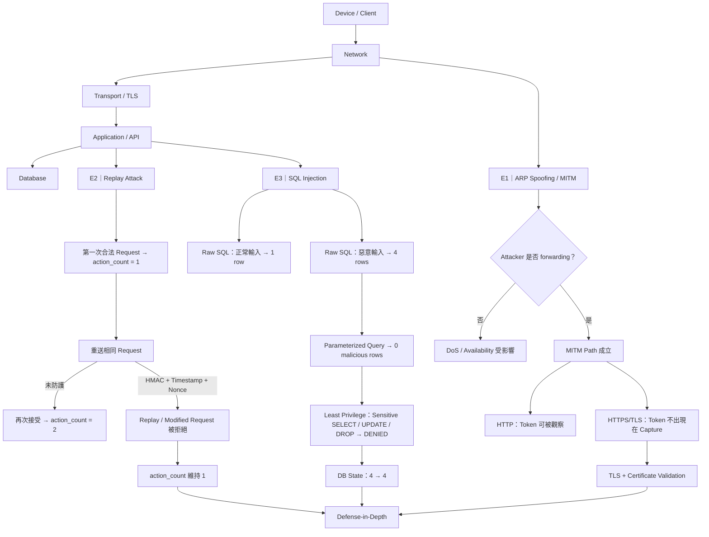

# IoT 資安作業整體流程圖

> 對應 Assignment #3 V2.2 的 E1 / E2 / E3。完整版高解析 PNG 已備份於 Google Drive，DOCX/PDF v3 亦已內嵌同一張流程圖。

[Google Drive｜高解析流程圖 PNG](https://drive.google.com/file/d/1gVQdnZZ0gIKsZ9PcQPG7nkuslEwu5yp7/view?usp=drivesdk)

## 一句話記憶

- **E1：路被劫持** → TLS + 憑證驗證保護 payload，但 TLS 不會阻止 ARP Spoofing。
- **E2：合法訊息被重播** → HMAC + Timestamp + Nonce 驗證 authenticity 與 freshness。
- **E3：資料被當成程式碼** → Parameterized Query 預防 root cause，Least Privilege 限制 blast radius。

**結論：不同 Trust Boundary 對應不同攻擊與控制，因此需要 Defense-in-Depth。**
