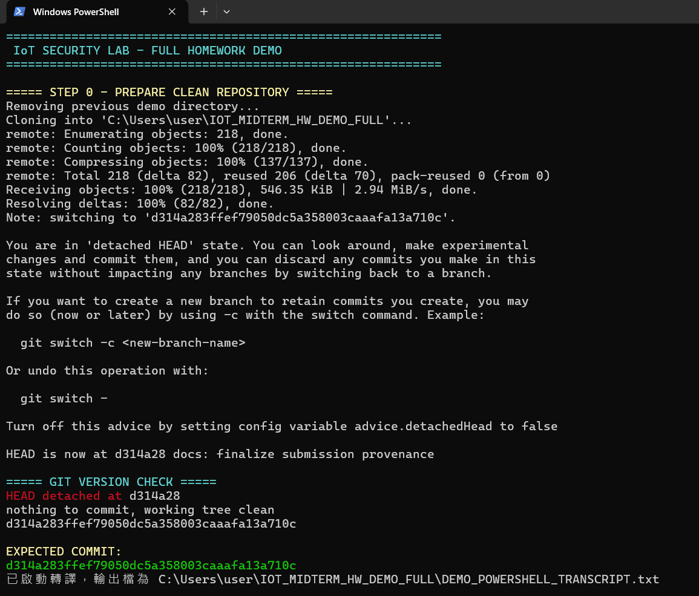
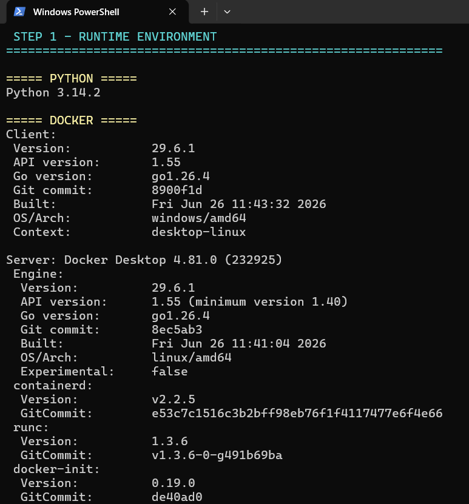
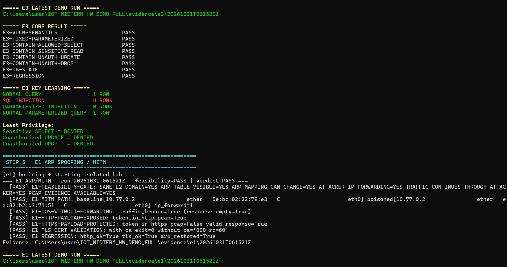
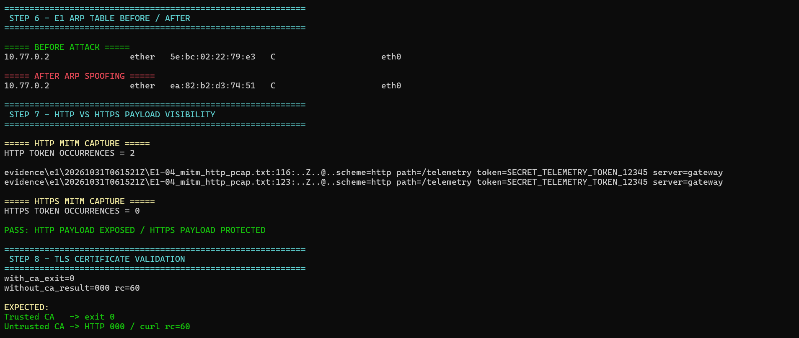
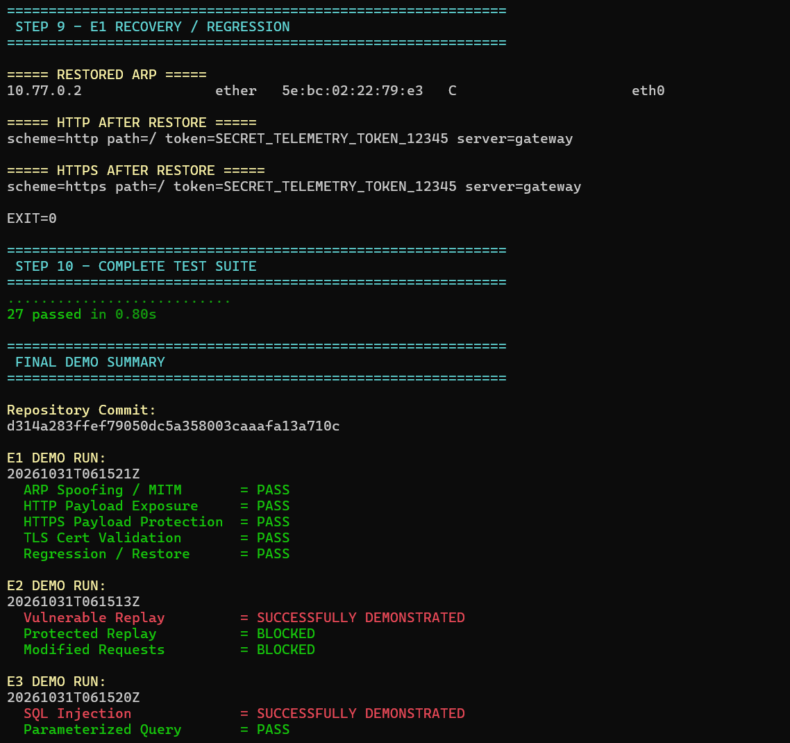
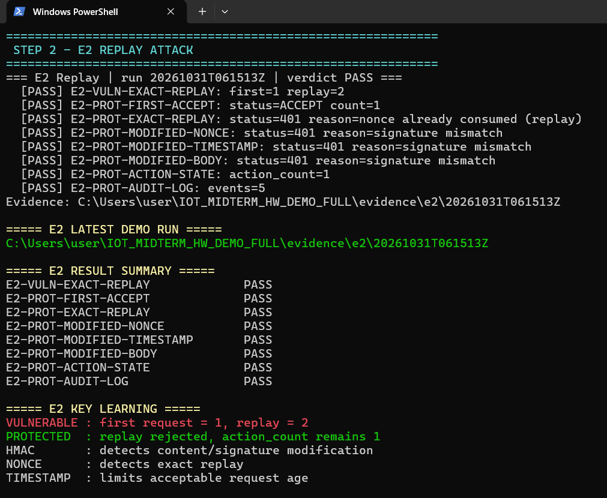
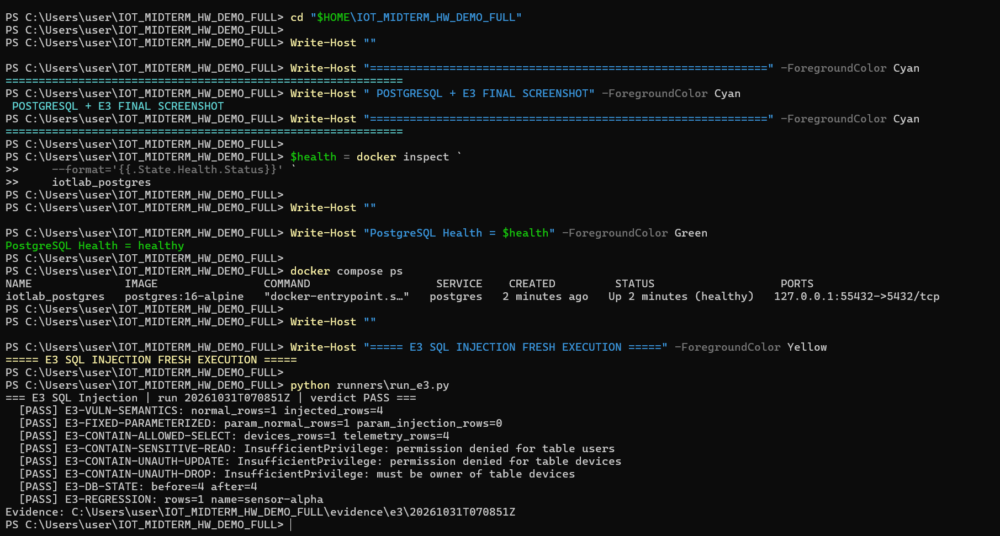
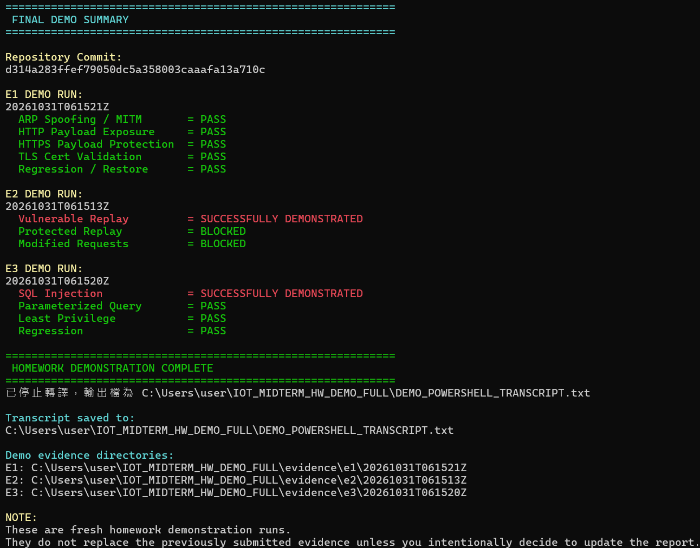

# 作業三｜物聯網攻擊實作與防禦方法探討

**IoT Security Lab V2.2｜繁體中文最終報告＋PowerShell 實作證據**

Repository baseline: `d314a283ffef79050dc5a358003caaafa13a710c`

| 實驗 | 正式最終 Run | Fresh Demo Run | 結果 |
|---|---|---|---|
| E1 ARP Spoofing / MITM | `20261030T193936Z` | `20261031T061521Z` | PASS |
| E2 Replay Attack | `20261030T193709Z` | `20261031T061513Z` | PASS |
| E3 SQL Injection | `20261030T193723Z` | `20261031T070851Z` | PASS |

完整測試：**27 passed, 0 failed, 0 skipped**。

本報告保留正式 evidence baseline；以下 PowerShell 圖片來自同一 Git commit 的 fresh demo run，用來補充課堂要求的實際操作證據與可重現性證明。

## 1. 核心概念

IoT Security 是跨層信任管理問題：

`Device -> Network -> Transport -> Message/Application -> Data`

- E1：網路路徑被 ARP Spoofing / MITM 劫持。
- E2：原本合法的 request 被 Replay。
- E3：User Input 被 Raw SQL 誤當成 Code。

## 2. 實驗版本與環境

## 3. E1 — ARP Spoofing / MITM

ARP 缺乏強式身分驗證。攻擊者可偽造 ARP Reply，使 Victim 將 Gateway IP 對應到 Attacker MAC。若攻擊者不 forwarding，結果是 DoS；開啟 forwarding 並讓流量持續通過攻擊者，才構成真正 MITM。

Fresh Demo 顯示：

- ARP Mapping 前後的 Gateway IP 相同，但 MAC 被改綁。
- HTTP capture 中測試 Token 出現 2 次。
- HTTPS capture 中 Token 出現 0 次。
- Trusted CA：exit 0。
- Untrusted CA：curl rc=60，HTTP 000，代表 TLS handshake 在 HTTP response 前終止。

TLS 不會阻止 ARP Spoofing，也不會修復 forwarding path；它是在 hostile network path 上保護 application payload confidentiality / integrity。

攻擊停止後 ARP Mapping 恢復，正常 HTTP / HTTPS 服務可再次使用，並通過 regression。

## 4. E2 — Replay Attack

Replay Attack 不需要破解 TLS。攻擊者只要取得一份合法 request，便可能原封不動再次送出。

- Vulnerable：first request = 1，replay = 2。
- Protected：exact replay 被 401 拒絕，`action_count` 保持 1。
- 修改 nonce / timestamp / body 但沿用舊 signature 均被拒絕。

控制：HMAC-SHA256 + Nonce + Timestamp + Per-Device Secret。

## 5. E3 — SQL Injection

E3 驗證 Application Data-Access / Code-Data Boundary 與 DB Authorization；HTTP transport 本身沒有被獨立驗證。

核心結果：

- Normal query：1 row。
- SQL Injection：4 rows。
- Parameterized Query + 同一惡意輸入：0 rows。
- 正常 Parameterized Query：1 row。
- Sensitive SELECT / UPDATE / DROP：DENIED。
- DB State：4 -> 4。

Parameterized Query 是 **PREVENT**；Least Privilege 是 **CONTAIN**，兩者作用不同。

Fresh clean rerun：先移除舊 `iotlab_postgres` 與 `iotlab_net`，重新以 Docker Compose 建立 PostgreSQL；容器確認 `healthy` 後再執行 E3。結果仍為 normal=1 row、injection=4 rows、parameterized malicious input=0 rows，Sensitive SELECT／UPDATE／DROP 均被拒絕。

## 6. Defense-in-Depth

| 層級 | 攻擊 | 實作控制 |
|---|---|---|
| Network | ARP Spoofing / MITM | TLS + Certificate Validation |
| Message | Replay | HMAC + Nonce + Timestamp |
| Application / Data | SQL Injection | Parameterized Query + Least Privilege |

沒有任何單一控制能處理所有 failure domain，因此 IoT Security 必須採取 Defense-in-Depth。

## 7. Fresh Demo 最終結果

Fresh Demo 從固定 commit 再次成功重現 E1 / E2 / E3，完整測試 27 passed。

## 8. 課堂概念對應

- CIA Confidentiality：HTTP Token 暴露 vs HTTPS/TLS 保護 Payload。
- CIA Integrity：ARP Mapping 被竄改；HMAC 驗證訊息完整性。
- CIA Availability：不 forwarding 時形成 DoS。
- PKI / Certificate：Trusted CA 成功、Untrusted CA 被拒絕。
- Freshness：Nonce + Timestamp。
- Access Control / Least Privilege：DB Role 限制。
- Defense-in-Depth：三個 Trust Boundary 各自配置不同控制。

## 9. 結論

E1 證明網路路徑可以被 ARP Spoofing 改變，而 TLS 只能保護 hostile path 上的 payload；E2 證明合法訊息仍可能被 replay，因此需要驗證 authenticity 與 freshness；E3 證明 SQL Injection 的 root cause 必須用 Parameterized Query 修正，再用 Least Privilege 控制 blast radius。整體結論是：IoT Security 必須以跨層 Defense-in-Depth 管理不同 Trust Boundary 的風險。
